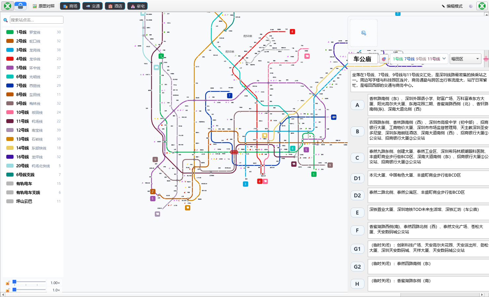
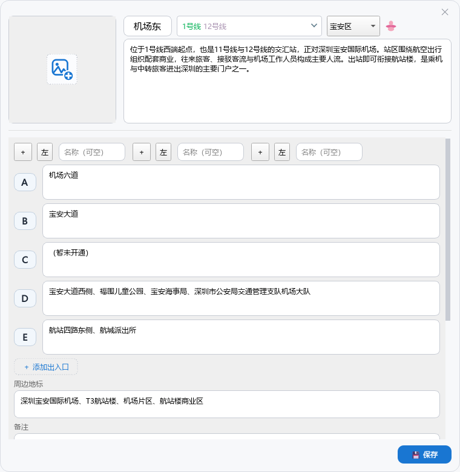

# 商业地图 · 深圳地铁线路图编辑器

> 把深圳地铁线路图变成一张**可交互、可编辑、可沉淀商业信息**的矢量地图。
> 线路和站点全部由程序绘制（不是贴图），在图上标注每个站的出入口、周边商业、
> 地标、首末班车…… 然后把这张图导出成一张图片带走。



<p align="center">
  
</p>

- **383 个站点、20 条线路**（含 6 号线支线 / 有轨电车 / 坪山云巴），坐标按官方图纸逐段核对过
- Windows 桌面程序：Python 3 + PySide6（Qt），打包成单个 exe，双击即用
- 当前版本 **v2.7.33**

---

## 目录

- [它是干什么的](#它是干什么的)
- [功能一览](#功能一览)
- [快速开始](#快速开始)
- [界面与快捷键](#界面与快捷键)
- [目录结构](#目录结构)
- [数据格式](#数据格式)
- [打包成 exe](#打包成-exe)
- [测试与回归](#测试与回归)
- [版本与变更](#版本与变更)
- [版权与免责声明](#版权与免责声明)

---

## 它是干什么的

深圳地铁线路图是一张很密的网。地铁站周围有什么商场、什么医院、哪几个出口通向哪儿，
这些信息散在官网、地图 App、各种帖子里 —— **看的时候要来回切，看完就忘**。

这个项目把这张网重画成矢量图，再把上面那些信息**一个站一个站地挂到图上**：

- 地图本身是**数据**（`data/stations.json` + `data/lines.json`），不是一个画死的大文件；
- 每个站有 20 来个字段，入口、设施、首末班车、周边商业地标、备注，随手补；
- 图上的"商场 / 交通 / 酒店 / 豪宅"四类图标可以按类别、按等级开关，
  于是同一张图既是**地铁图**，也是**商业网络图**；
- 最后可以导出成图片（看图模式），发给别人或存档。

一句话：**它是一张会越用越厚的地铁图。**

---

## 功能一览

### 地图

- 线路按**八方向布线**绘制，站点压在线上，拐角走圆角；缩放时字号跟着放大
- 滚轮缩放**以鼠标位置为锚点**，按住空白处拖动平移（中键也可以）
- 左侧图例：悬浮高亮该线路（其余变淡），单击定位到该线路
- 站名可拖动、可固定方位 —— 缩放时不会上下乱窜（方位锁 + 文字锁）
- 状态栏显示当前倍率 / 坐标，右下角有倍率面板

### 站点信息

- 单击站点 → 右侧详情面板；双击站点 → 完整编辑弹窗；空白处双击 → 新建站点
- 悬浮站点出气泡，把已写的信息列出来（**设了封面图的话，图片显示在气泡最上方**）
- 字段：线路 / 换乘 / 行政区 / 出入口（编号+内容，支持"暂未开通"）/ 设施 /
  首末班车表格 / 开通日期 / 周边地标 / 公交接驳 / 车道数 / 备注 / 站点简介
- 站点封面图存在 `data/covers/`，按站点名归档

### 商业图层

- 四类图标：**商场 / 交通 / 酒店 / 豪宅**，每类可整类开/关
- 每一类下还有等级（红 / 金 / 紫 / 绿），**右键**类别按钮挑等级
- 关掉的类别在主图上全部隐藏 ⇒ 只留你想看的那个维度

### 看图模式（导出图片）

- 一键把整张图烘成**一张位图**：之后缩放/平移是"看照片"，几百个矢量图元不再重排，丝滑
- 可以设置：生成时机、定时自动保存、退出时是否询问、图片存到哪
- 退出看图模式回到矢量编辑，两边状态互不污染（锁态、视野都会还原）

### 对着官方原图干活

- 🖼 **原图对照**：把官方线路图垫在底下，半透明切换着比
- 🧲 **吸附到原图**：把站点坐标吸到官方图上的对应位置
- 📏 **偏差检查**：算出自己画的线相对官方图的偏差，列出偏差最大的段落
- 🧭 **自动描线**：沿着底图上的颜色自动生成线路轨迹

### 数据与稳定

- 撤销 / 重做（含拖站点、改文字、新建删除），改动**落盘**到 JSON
- **界面看门狗**：主线程卡超过 3 秒会记录到日志（这个项目早期出过"打字未响应"，
  所以常驻一个看门狗盯着）
- 站点文案批处理：把一批站点丢给 AI 写简介 → 校验器查格式/查幻觉 → 导入
  （`站点文案/` 里是批次与导入包，`tools/` 里有校验器）

---

## 快速开始

### 方式一：下载 exe（推荐普通使用）

1. 到 [Releases](https://github.com/yiming2016/business-map/releases) 下载最新
   `SZ_MetroEditor.exe`
2. 放到一个**空文件夹**里双击运行。首次启动会在 exe 旁边自动生成 `data/`
   （初始的 `stations.json` / `lines.json` / `schema.json`），`logs/` 里是运行日志
3. 之后所有编辑都在这个 `data/` 里 ⇒ **整个文件夹拷走就是完整备份**

> 只支持 Windows x64。

### 方式二：从源码跑

```cmd
:: 1) 建虚拟环境（Python 3.13 测过；3.10+ 应该都可以）
python -m venv .venv
.venv\Scripts\activate

:: 2) 装依赖
pip install -r requirements.txt

:: 3) 跑
python main.py
```

源码模式读的是 `源码/data/`，和 exe 的 `软件/data/` **互不影响** ——
要让开发版用同一份数据，把 `软件\data\` 拷过来即可。

### 官方底图（可选，仓库里没有）

"原图对照 / 吸附到原图 / 偏差检查 / 自动描线"这几个功能需要一张官方线路图垫底。
**版权归深圳地铁（szmc.net），所以没有放进仓库**。自己把图放到这两个位置即可：

```
data/underlay.png            # 4000×4000 及以上
assets/shenzhen_metro.png    # 同一张图（工具脚本按它算坐标）
```

不放也能用 —— 只是上面那四个功能没得对照。

---

## 界面与快捷键

```
┌──────────────────────────────────────────────────────────┐
│ 工具栏：🖼原图对照 商场 交通 酒店 豪宅   ✎编辑模式  ⚙️ …  │
├──────────┬──────────────────────────────┬────────────────┤
│  图例    │        矢量线路图            │   站点详情面板  │
│ 20 条线  │   （滚轮缩放 / 拖动平移）     │   （可编辑）    │
│ 悬浮高亮 │                              │                │
│ 点击定位 │                              │                │
└──────────┴──────────────────────────────┴────────────────┘
        左右两个面板都是**浮层**（盖在地图上，边缘可拖宽）
```

| 操作 | 方式 |
|---|---|
| 单击站点 | 打开右侧详情面板 |
| 双击站点 | 弹出完整编辑窗口 |
| 双击空白处 | 新建站点 |
| 悬浮站点 | 气泡提示已写入的信息（含封面图） |
| 按住空白处拖动 | 平移地图 |
| 按住中键拖动 | 平移地图（任何位置可用） |
| 拖动站点 / 站名 | 移动站点坐标 / 单独挪站名 |
| 滚轮 | 缩放（以鼠标为锚点） |
| **↑ ↓ ← →** | 沿最近方向选下一个站点 |
| **Tab** | 跳到下一个最近站点 |
| **Enter** | 等同双击（打开编辑窗口） |
| **Esc** | 取消选择 / 退出全屏 |
| Ctrl+N | 新建站点 |
| Ctrl+M | 添加模式（点一下就落一个站） |
| Ctrl+S | 保存 |
| Ctrl+Z / Ctrl+Y | 撤销 / 重做 |
| Ctrl+0 / Ctrl+1 | 适配窗口 / 100% 缩放 |
| **F11** | 全屏 |
| 搜索框输入 | 下方实时出候选，↑↓ 选、Enter 定位、Esc 关掉 |

---

## 目录结构

```
.
├── main.py                     入口（APP_VERSION 在这里）
├── build_exe.py                一键打包（成品输出到同级 ../软件/）
├── build_exe.bat               Windows 批处理版本
├── requirements.txt
├── core/                       数据层
│   └── data_manager.py         JSON 读写 + 首启动初始化
├── ui/                         视图层（22 个模块）
│   ├── metro_render.py         矢量渲染核心：八方向布线 / 站点圆点 / 离屏缓存
│   ├── map_view.py             地图视图：缩放平移、命中判定、拖动、对齐
│   ├── main_window.py          主窗口：把各视图拼起来 + 浮层布局
│   ├── image_mode.py           看图模式：整张图烘成位图
│   ├── image_settings_dialog.py 看图模式设置
│   ├── legend_panel.py         左侧图例（浮层，可拖宽）
│   ├── info_panel.py           右侧详情面板（浮层，可拖宽）
│   ├── edit_dialog.py          站点编辑弹窗
│   ├── exits_editor.py         出入口"编号 + 内容"两栏编辑器
│   ├── timetable_editor.py     首末班车表格编辑器
│   ├── icon_toggle_panel.py    商场/交通/酒店/豪宅 四类图标开关
│   ├── scale_panel.py          右下角倍率面板
│   ├── trace_assist.py         自动描线
│   ├── autofit.py              字号与站名自适应
│   └── …
├── tools/                      开发/回归脚本（见下方"测试与回归"）
├── data/                       开发数据
│   ├── stations.json           站点（383 个）
│   ├── lines.json              线路（20 条）
│   ├── schema.json             站点字段规范（给 AI 看的接口说明）
│   ├── covers/                 站点封面图
│   └── 导出/                   导出的图片
├── assets/                     logo / 图标（官方底图不入库）
├── docs/                       README 截图 + 开发日志
└── 站点文案/                    AI 批量生成的站点文案批次与导入包
```

---

## 数据格式

### `data/stations.json`

```jsonc
{
  "version": "…",
  "description": "…",
  "stations": {
    "机场东": {                      // 站名作键
      "station_id": "0101",
      "station_name": "机场东",
      "x": 1234.5, "y": 678.9,      // 地图坐标（场景单位）
      "lines": ["1", "12"],          // 所属线路
      "is_transfer": true,
      "district": "宝安区",
      "open_date": "2013-11-28",
      "exits": [{"code": "A", "text": "机场六道"}],
      "facilities": { … },           // 设施（无障碍电梯、洗手间…）
      "timetable": { … },            // 首末班车
      "landmarks": "深圳宝安国际机场、T3 航站楼…",
      "bus_transfer": "…",           // 公交接驳
      "lanes": 2,                    // 车道数
      "notes": "…",                  // 备注
      "description": "…",            // 站点简介
      "label_dx": 12, "label_dy": -8,   // 站名相对圆点的偏移（手拖出来的）
      "label_side": "右",            // 站名挂在哪个方位
      "official_label_side": "右",   // 官方图上的方位（对齐用）
      "pill": { … },                 // 站点胶囊/标签样式
      "_updated_at": "2026-10-15 00:54"
    }
  },
  "transfer_links": [ … ],          // 换乘通道连线
  "through_links": [ … ]            // 直通/贯通运营连线
}
```

### `data/lines.json`

```jsonc
{
  "version": "…",
  "lines": [
    { "id": "1", "name": "罗宝线", "color": "#00A950",
      "stations": ["0101", "0102", …] }
  ],
  "segment_shapes": { … },          // 每段线的走形（八方向布线结果）
  "traced": { … },                  // 自动描线出来的轨迹
  "octi_off": { … }                 // 八方向布线的偏移量
}
```

> ⚠️ 这两个文件是程序**唯一的数据源**。手改 JSON 也能生效（程序启动时读），
> 但改前先备份 —— 程序自己的备份放在 `data/*.bak*`（这些不入库）。

---

## 打包成 exe

```cmd
python -m pip install pyinstaller
python build_exe.py
```

- 成品：`../软件/SZ_MetroEditor.exe`（单文件，约 45 MB）
- 打包时会把 `data/` 下的普通文件塞进 exe 作为**初始数据**
  （首启动只复制 `stations.json` / `lines.json` / `schema.json`）
- 脚本会先关掉正在运行的旧 exe、只清理输出目录里的**旧文件**（`data/` `logs/` 绝不碰）

---

## 测试与回归

这个项目是"改一处、跑一堆脚本"的干活方式，`tools/` 下有 **50 多个**
`_chk_*.py` 回归脚本，每条都带**变异自检**（故意把代码改成错的，看判据会不会炸 ——
不炸就说明这条判据是摆设）。

```cmd
:: GUI 脚本一律离屏跑：不弹窗、不抢焦点，屏幕上什么都不出现
set QT_QPA_PLATFORM=offscreen
set METROEDITOR_NO_VIEW_START=1

python tools\_chk_click_no_save.py       :: 单击站点不该写盘
python tools\_chk_label_lock_drag.py     :: 站名固定方位 + 可单独拖动
python tools\_chk_scale_panel.py         :: 缩放面板与快捷键
python tools\_chk_exit_ask.py            :: 退出时该不该问"保存为图片"
python tools\_chk_overlay_narrow.py      :: 窗口拉窄，两个浮层不许把地图盖满
```

开发日志里记了每条为什么会存在、以及踩过的坑，见
[docs/变更日志.md](docs/变更日志.md)。

---

## 版本与变更

- 当前：**v2.7.33**
- 每一版的下载与变更说明：[Releases](https://github.com/yiming2016/business-map/releases)
- v2.6.18 及更早的开发日志：[docs/变更日志.md](docs/变更日志.md)

---

## 版权与免责声明

- **代码与数据**：© 2026 yiming2016。仓库暂未附开源许可证（未声明 = 保留所有权利），
  如需转载、二次分发，请先开 Issue 说一声。
- **官方线路图**：深圳地铁线路图版权归**深圳地铁（szmc.net）**所有。
  本仓库**不包含**官方底图；程序里"原图对照"等功能的参考图需使用者自行准备。
- **站点信息**：出入口、首末班车、周边商业等数据**以官方发布为准**，
  本项目记录的内容仅供个人参考，不作为出行或投资的依据。

---

## 联系

Issues / PR 都欢迎：<https://github.com/yiming2016/business-map/issues>
